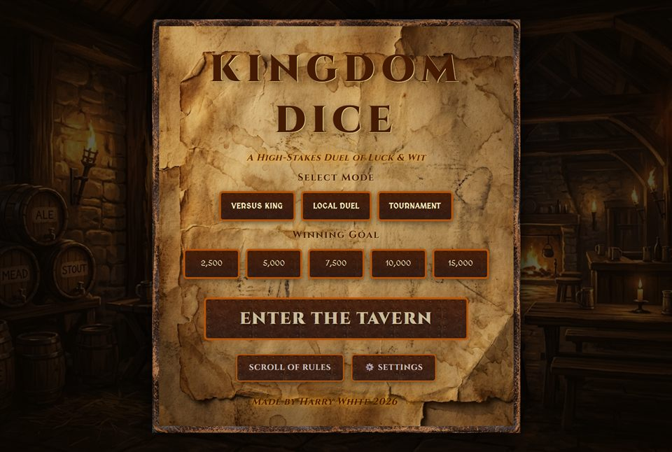
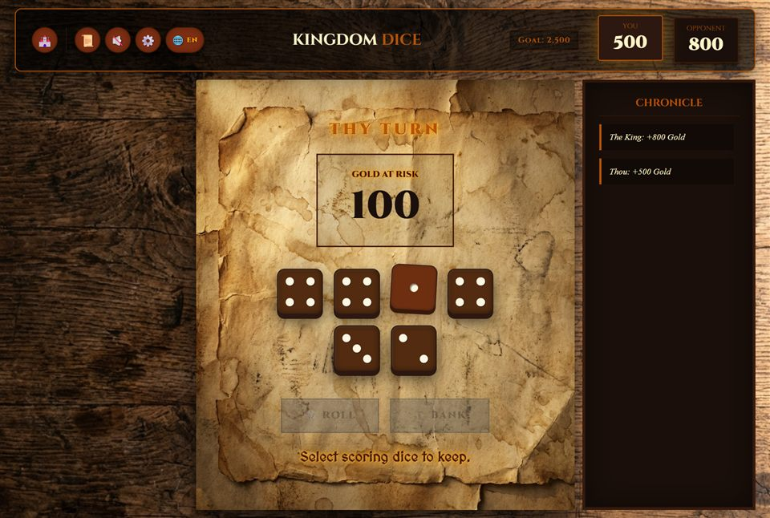

# 🎲 Kingdom Dice — Medieval Farkle

<p align="center">
  
</p>

<p align="center">
  <strong>A rustic, high-stakes medieval Farkle duel of luck &amp; wit.</strong><br>
  Roll hot streaks, bank thy gold, and dethrone the King — in the browser, on Windows, or on Android.
</p>

<p align="center">
  <a href="https://haarrywhiite.github.io/Farkle/"></a>
  <a href="https://github.com/haarrywhiite/Farkle/releases/latest"></a>
  <a href="LICENSE"></a>
</p>

<p align="center">
  
</p>

---

## ⚔️ Overview

**Kingdom Dice** brings the classic dice game of Farkle into a rich tavern setting complete with parchment UI, wooden tavern textures, smooth dice rolling physics, and dynamic AI opponents.

### 🌟 Highlights

- **Multiple Game Modes**:
  - 👑 **Versus King**: Challenge AI opponents across Apprentice, Knight, and King difficulties.
  - 👥 **Local Duel**: Pass-and-play with a friend on the same screen.
  - 🏆 **Tournament**: Climb through bracketed tavern tournament rounds.
- **Cross-Platform, self-updating**:
  - 🌐 **Web**: Instant gameplay on [GitHub Pages](https://haarrywhiite.github.io/Farkle/) — installable as a PWA, works offline.
  - 🖥️ **Windows Desktop**: Native Electron app with a custom installer and background auto-updates.
  - 📱 **Android**: Powered by Capacitor, with one-tap in-game updates.
- **Authentic Medieval Aesthetics**: Custom typography, tavern backgrounds, leather mats, parchment scoring cards, and golden flourishes.
- **Tavern Soundtrack**: A built-in CC0 playlist (no attribution needed, works fully offline).
- **Multilingual Support**: Fully localized with dynamic in-game language switching (English / Spanish).

<p align="center">
  
</p>

---

## 🎯 How to Play

1. **Roll the Dice**: Roll 6 dice onto the tavern table.
2. **Keep the Gold**: Select scoring dice (ones, fives, triples, straights...).
3. **Roll or Bank**: Risk the remaining dice to grow the pot, or bank the gold safely.
4. **Mind the Purse**: Your first bank of a game must be worth **500+** gold — until then your purse stays locked.
5. **Beware the Farkle!**: If a roll contains no scoring dice, you Farkle and lose all unbanked points from that turn.
6. **Hot Dice**: Score with all 6 dice and earn a fresh set of 6 to keep the streak alive.
7. **Victory**: First to the target score (2,500–15,000, thy choice) — with a final round for the last player — takes the crown!

### 🧮 Scoring Table

| Combination | Points |
| --- | --- |
| Single **1** | 100 |
| Single **5** | 50 |
| Triple **1s** | 1,000 |
| Triple **2s** / **3s** / **4s** / **5s** / **6s** | face value × 100 |
| Four of a kind | base × 2 |
| Five of a kind | base × 3 |
| Six of a kind | base × 4 |
| Straight (1–6) | 1,500 |
| Three pairs | 1,500 |
| Two triplets | 2,500 |

*Four/five/six of a kind pay double/triple/quadruple the triple value of that face — e.g. four 6s = 1,200, six 1s = 4,000.*

---

## 🌐 Play Online

Nothing to install: open [haarrywhiite.github.io/Farkle](https://haarrywhiite.github.io/Farkle/) and roll. The game is a full PWA — install it from your browser's address bar to keep a tavern shortcut that runs offline.

---

## ⬇️ Downloads

Grab the latest installer or APK from the [Releases page](https://github.com/haarrywhiite/Farkle/releases/latest):

| Platform | Asset | Auto-updates |
| --- | --- | --- |
| 🖥️ Windows | `Farkle-Setup-x.y.z.exe` | ✅ checks on launch, downloads in background |
| 📱 Android | `Farkle-x.y.z.apk` | ✅ one-tap in-game update banner |

> **Note for Windows players:** the installer is not code-signed yet, so Microsoft Defender SmartScreen may show an *"unrecognized app"* warning on first run. Choose **More info → Run anyway**. (See [Signing](#-signing--key-rotation) for how this gets fixed properly.)

---

## 🛠️ Getting Started (Development)

### Prerequisites

- [Node.js](https://nodejs.org/) (v20 or v22 recommended)
- `npm`

### Install & run

```bash
git clone https://github.com/haarrywhiite/Farkle.git
cd Farkle
npm install
npm run dev
```

The dev server serves `src/` directly (port 3000, falls forward if busy). To run the desktop wrapper in development:

```bash
npm run desktop:start
```

### Building releases

- **Web build** (copies assets into `www/` and stamps `www/version.json`):
  ```bash
  npm run build
  ```
- **Windows installer** (into `release/`):
  ```bash
  npm run desktop:build
  ```
- **Android APK** (after the web build):
  ```bash
  npm run build
  npx cap sync android
  cd android && ./gradlew assembleRelease
  ```
  In practice, tag a release (`git tag vX.Y.Z && git push origin vX.Y.Z`) and the GitHub workflow builds **both** installers and attaches them to the release — see below.

---

## 🔄 Auto-Updates

- **Windows**: installed apps check GitHub Releases on launch (electron-updater). A new release downloads itself in the background and offers "Restart now". Nothing to do manually.
- **Android**: on launch the app compares its bundled version against the latest GitHub release. If a newer `Farkle-x.y.z.apk` asset is attached, an in-game banner offers a one-tap download + install.
- When bumping versions, always **increment `versionCode`** in `android/app/build.gradle` (never reuse) — Android refuses an update whose versionCode is not newer than the installed one.

### 🔐 Signing & key rotation

- Android APKs are signed by the release workflow using GitHub Secrets: `APK_KEYSTORE` (a base64 PKCS12 file), `APK_KEYSTORE_PASSWORD` and `APK_KEY_ALIAS`. The keystore never lives in the repository.
- The original PWABuilder keystore spent months inside git history (`app/signing.keystore` + password) and is therefore considered compromised: it was **retired on 2026-10-18** and replaced with a fresh key. Do not reuse it.
- `app/assetlinks.json` retains **both** certificate fingerprints (old + new) so previously established Digital Asset Links trust keeps resolving.
- Windows installers are **unsigned** until a code-signing certificate is configured — that is why Microsoft Defender SmartScreen shows the "unrecognized app" warning. The only real fix is an **OV or EV code-signing certificate** (e.g. Certum's open-source developer program at roughly €69/year, or EV for instant SmartScreen removal). Once you have the `.pfx`, add `WINDOWS_CERTIFICATE` (base64) + `WINDOWS_CERTIFICATE_PASSWORD` secrets and the workflow signs all builds automatically.

---

## 🗂️ Project Structure

```text
├── .github/
│   └── workflows/
│       ├── release.yml       # Builds & publishes Windows + Android releases on tags
│       └── pages.yml         # Deploys the built web app to GitHub Pages
├── android/                  # Android Capacitor project (APK builds)
├── app/                      # Digital asset links for the Android app
├── docs/                     # Screenshots used by this README
├── electron/                 # Desktop wrapper (main process, auto-updates, icon build)
├── scripts/                  # Dev tooling (build, dev server, icon generator)
├── src/                      # Web application source
│   ├── css/                  #   Modular stylesheets (bracket, buttons, styles)
│   ├── js/                   #   Game engine (AI, scoring, dice physics, UI)
│   ├── img/                  #   Artwork, tavern backgrounds, dice & icons
│   ├── audio/                #   Tavern soundtrack (CC0, public domain)
│   ├── index.html            #   Main game entry point
│   ├── manifest.json         #   PWA manifest
│   └── sw.js                 #   Service worker (offline caching)
├── capacitor.config.json     # Mobile app configuration
└── package.json              # Scripts & project dependencies
```

---

## 🤝 Contributing

Contributions, issues, and feature requests are welcome! Feel free to check the [issues page](https://github.com/haarrywhiite/Farkle/issues).

---

## 🎵 Music

Tavern soundtrack tracks are from [FreePD.com](https://freepd.com) — all **CC0 public domain**, so **no attribution or license credit is required**. Music plays locally from `audio/` (works fully offline).

- *Bar Brawl* — Bryan Teoh — `audio/bar-brawl.mp3`
- *Village Tarantella* — Kevin MacLeod — `audio/village-tarantella.mp3`
- *Still Pickin'* — Kevin MacLeod — `audio/still-pickin.mp3`

## 📄 License

This project is licensed under the [ISC License](LICENSE).
